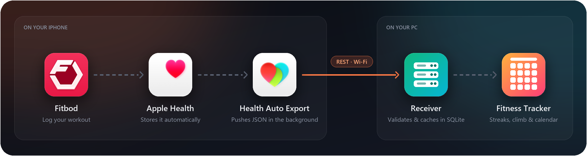
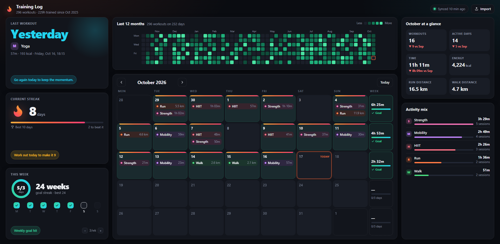

<div align="center">



<h1>Health &amp; Fitness Tracker</h1>

<p><strong>A private, self-hosted workout dashboard that fills itself from your iPhone.</strong></p>

<p>
Log a session in <a href="https://apps.apple.com/us/app/fitbod-gym-fitness-planner/id1041517543">Fitbod</a> (or any app that writes to Apple Health),
and <a href="https://apps.apple.com/us/app/health-auto-export-json-csv/id1115567069">Health Auto Export</a>
pushes it to a small receiver on your PC. The dashboard turns it into streaks, a year heatmap and a
training calendar, so you always know when you last trained and what keeps the streak alive. Your
weekly streak becomes Carl, a little climber working his way up a new mountain every two months.
</p>

<p>


</p>

<p>
<a href="#setup">Setup</a> ·
<a href="#design">Design</a> ·
<a href="#api">API</a> ·
<a href="#security-and-privacy">Privacy</a>
</p>

</div>

<br>


<p align="center"><sub>Dashboard shown with generated demo data.</sub></p>

## Highlights

- **Zero-touch sync.** Health Auto Export pushes new workouts in the background. Nothing to tap, no cloud
  account, no third-party server in between.
- **Built to keep you consistent.** Time since your last workout with a rest-day-aware nudge, a weekly goal
  ring (3 workouts by default, adjustable) with each day of the week ticked off, a weekly streak (weeks in a
  row with any workout) with your personal best, and a GitHub-style heatmap of the last 12 months.
- **Carl's climb.** The weekly streak card shows Carl climbing six themed mountains a year, one every
  8 weeks: Pine Ridge, Red Rock Mesa, Ember Peak, Frost Spire, Canopy Crag and Summit of Stars. He pitches a
  new camp on each summit, and after a full year the cycle repeats as a higher tier. Each summit
  brings home a souvenir, wildlife drops by on some weeks, and the sky follows your clock (Carl sleeps in
  his tent or climbs by headlamp at night). Click the climb for the trail map: the whole range, your best
  point, summits, falls and the souvenir shelf. See [climb rules](#carls-climb).
- **A campfire for your last workout.** It blazes on a training day and burns down a step each day after,
  to embers and then a wisp of smoke, until the next workout relights it.
- **Recent form.** The last 12 weeks as batteries (one cell per workout of the goal), box plots of your last
  6 sessions' duration and calories, and a smoothed workouts-per-week trend since you started.
- **Daily activity too.** Steps (with a 10k goal and 7-day bars), walking distance, active energy, flights
  and a 30-day weight trend from a second Health Metrics automation; each calendar day shows its steps.
- **One-screen dashboard.** Everything fits on one screen without scrolling, from 1080p down to small laptop
  windows (less important details hide first). It falls back to a scrolling layout on phones.
- **Correct data.** Units normalised to metric, timezones preserved (a late-night workout stays on its day),
  re-sent workouts de-duplicated, and one malformed workout never blocks the rest of a sync.
- **Private by default.** Token-protected ingest, dashboard reachable only from your PC, all data in a
  single git-ignored SQLite file.

## How it works

```
Workout → Apple Health
   ▼  Health Auto Export "REST API" automation (background, JSON v2)
POST http://<PC-IP>:8765/api/v1/ingest/health-auto-export   (Bearer token)
   ▼  validate → normalize (units, timezones) → idempotent upsert
SQLite cache  data/workouts.db
   ▼
Dashboard   http://localhost:8765
```

The receiver runs whenever the PC is on. If the PC is off when the phone tries to sync, the next sync
catches up as long as the automation's date range overlaps (e.g. "Previous 7 Days"). Re-sent workouts are
de-duplicated.

## Setup

### 1. Start the receiver
```
run.bat
```
On first run this creates `.venv`, the database and a random ingest token (`data/ingest_token.txt`),
then prints the exact values for the phone and opens the calendar.

Optional: start it automatically at logon (no browser window):
```
powershell -ExecutionPolicy Bypass -File install-startup.ps1
```

### 2. Allow the phone to reach the PC (once)
- Open only this port, only to devices on your local network (run PowerShell **as administrator**).
  This works on a Public network profile, so nothing else on the PC is exposed:
  ```
  New-NetFirewallRule -DisplayName "Health Auto Export receiver" -Direction Inbound -Protocol TCP -LocalPort 8765 -RemoteAddress LocalSubnet -Action Allow -Profile Any
  ```
  Undo with `Remove-NetFirewallRule -DisplayName "Health Auto Export receiver"`.
- Check from the iPhone's Safari: `http://<PC-IP>:8765/api/v1/health` should show `{"status":"ok"}`.
- Reserve the PC's IP in your router (DHCP reservation) so the URL doesn't change.

### 3. Create the automation in Health Auto Export
| Setting | Value |
|---|---|
| Automation type | REST API |
| URL | `http://<PC-IP>:8765/api/v1/ingest/health-auto-export` |
| Headers | `Authorization` = `Bearer <token from data/ingest_token.txt>` |
| Data type | Workouts |
| Include route data / workout metrics | On |
| Export format / version | JSON / Version 2 |
| Date range | Last 7 days (overlap covers syncs missed while the PC was off) |
| Batch requests | On |
| Sync cadence | Hourly, or the shortest available |

Allow **Local Network** access when iOS asks, then run a **Manual export** over a large date range once
to backfill history. You can also import an exported JSON file with **Import JSON** in the calendar.

### 4. Optional: daily health metrics
Duplicate the automation and change only these settings (same URL and header):

| Setting | Value |
|---|---|
| Data type | Health Metrics |
| Metrics | Step Count, Walking + Running Distance, Active Energy, Flights Climbed, Weight & Body Mass |
| Summarize data | On, Time Grouping: **Day** |
| Date range | Previous 7 Days |

Summarized daily values come from HealthKit's statistics, which de-duplicate overlapping iPhone and Watch
samples. Unsummarized samples from several devices can overlap and inflate daily step totals.

## Design

| Layer | Module |
|---|---|
| HTTP, auth, limits, error format | `app/main.py` |
| Envelope + per-workout processing, batch records | `app/ingest.py` |
| HAE v2 → canonical model | `app/normalize.py`, `app/units.py`, `app/timeparse.py` |
| Schema + migrations (`PRAGMA user_version`) | `app/db.py` |
| Read queries shaped for the API | `app/queries.py` |
| Streaks, per-day and per-week activity | `app/analytics.py` |
| Health metrics storage + daily aggregation | `app/metrics.py` |
| Dashboard UI (vanilla JS, no build) | `static/` |

**Data model.** `workouts` holds one row per workout with core summary columns (duration, distance, energy,
elevation, heart rate) in canonical units (m, s, kcal, bpm, m/s, °C). Anything else (temperature, MET,
swim fields, new HAE fields) lands in `extra_metrics` JSON, so new activity types and metrics need no
migration. Time series (heart rate, steps, power, …) go to `workout_metrics`, GPS points to
`workout_route_points`. `ingestion_batches` records every push. The latest raw payload per workout is kept in
`raw_workout_payloads` for reprocessing (disable with `HAE_STORE_RAW=0`).

**Timestamps.** HAE sends `yyyy-MM-dd HH:mm:ss Z`. Stored as fixed-width UTC text plus the original offset;
the calendar uses the local date the workout started in (a 23:30 walk stays on that day). Timestamps
without an offset are rejected, never assumed UTC.

**Idempotency.** Identity is HAE's workout `id` (HealthKit UUID).
- Same payload again → `unchanged`, no writes.
- Changed payload → summary updated; fields missing from the new payload keep their stored value.
- Each metric type present in the new payload replaces that workout's series (no duplicate samples);
  metric types/routes absent from the new payload are kept.
- Each workout is processed in its own savepoint: one malformed workout fails alone, the rest commit.
- HAE never sends deletions; delete a workout with `DELETE /api/v1/workouts/{id}`.

**Health metrics.** `data.metrics` samples are stored in `health_metric_samples`, one row per
(metric, timestamp, source), in canonical units with the exported unit kept for display (e.g. weight in lb).
Re-sent samples update in place. Daily values are computed on read: cumulative metrics (steps, distance,
energy, flights) are summed, body measurements (weight, body fat) use the day's latest reading, everything
else is averaged.

**One session, one record.** A workout of the same category starting within 2 minutes of a stored one is
treated as the same session, regardless of its id (Fitbod sometimes writes one workout to Apple Health twice).
Sources are ranked, with Apple Health via HAE above one-off imports: a duplicate of an equal or higher-ranked
record is skipped, and an Apple Health record arriving later replaces an imported copy. Ingest responses
report both counts under `deduplication`.

**Known HAE quirk.** `heartRateData` sometimes contains the post-workout recovery series
([issue #60](https://github.com/Lybron/health-auto-export/issues/60)). If every sample is at/after the
workout end it is stored as `heart_rate_recovery` and the workout is flagged.

## API

All responses are JSON; errors are `{"error": {"code", "message", "details"}}`. Interactive docs at
`/api/docs`.

| Endpoint | Access |
|---|---|
| `POST /api/v1/ingest/health-auto-export` | Bearer token (the phone) |
| `POST /api/v1/import` | this PC only (manual file import) |
| `GET /api/v1/status` | this PC only — counts and last sync |
| `GET /api/v1/workouts?from=&to=&category=&activity_type=&sort=-start&limit=50&offset=0` | this PC only |
| `GET /api/v1/workouts/{id}` · `/metrics?type=` · `/route` | this PC only |
| `DELETE /api/v1/workouts/{id}` | this PC only |
| `GET /api/v1/analytics/overview?today=YYYY-MM-DD&weekly_goal=3` | this PC only — last workout, day/week streaks, totals |
| `GET /api/v1/analytics/days?from=&to=` | this PC only — per-day counts and time (heatmap) |
| `GET /api/v1/analytics/weekly?today=YYYY-MM-DD` | this PC only — workouts per week since the first workout (zero-filled) |
| `GET /api/v1/metrics` | this PC only — health metrics received, with date ranges |
| `GET /api/v1/metrics/daily?names=step_count,weight_body_mass&from=&to=` | this PC only — daily values per metric |

**Streak rules.** The headline streak (`active_week_streak`) counts consecutive Monday-start weeks with
at least one workout of any kind. Separately, `week_streak` tracks weeks reaching the weekly goal
(`weekly_goal`, default 3 workouts; two workouts on one day count twice), shown as this week's progress.
For both, the current week joins once it qualifies; until then the streak runs through last week and is
flagged `at_risk`, with `remaining` workouts and `days_left`. `today` comes from the viewer so streaks never
depend on the server's timezone.

### Carl's climb

The climb is replayed in the browser from `/analytics/weekly`, so it needs no stored state:

- Each week with at least one workout is one step up. Week 4 is a rock ledge and week 8 the summit, where Carl
  pitches a camp. His next workout starts the next mountain.
- A missed week drops him to the base of the mountain he is on. Standing on a summit counts as being on it.
- Missing a week while he is already at a base drops him down the previous mountain to its base, so each
  further missed week costs one more mountain. At the first base camp there is nothing left to lose.
- The current week only counts once it has a workout. Until then Carl hangs on (or waits at the summit)
  with a warning.

The streak number itself still follows the streak rules above and resets on any missed week.

The weekly goal (3 workouts by default) adds rewards on top of the climb, without changing it:

- **Gold steps and medals.** A week that hits the goal turns its step of the route gold. Each summit earns
  a medal for how many of its 8 weeks hit the goal: gold for 7 or more, silver for 4 to 6, bronze below
  that. A medal is lost only if the summit is lost.
- **Base camp grows.** Lifetime goal weeks unlock camp upgrades that are never taken away: a campfire (1),
  a flag (3), a lantern (6), string lights (10), a woodpile (15) and a second tent (21).

Goal weeks use the weekly goal currently set on the dashboard, so changing it re-scores past weeks.

`from`/`to` are local dates, `from` inclusive and `to` exclusive. Distance and pace are only reported
for distance-based categories (run, walk, hike, cycle, swim, row).

Example ingest response:
```json
{"batch_id": 12, "status": "succeeded",
 "workouts": {"received": 3, "inserted": 1, "updated": 0, "unchanged": 2, "failed": 0},
 "ignored_data_types": {}, "errors": []}
```

## Security and privacy
- Ingest requires a 256-bit bearer token; 10 bad tokens in 5 minutes locks the client out.
- Dashboard API answers only requests from this PC (`HAE_DASHBOARD_ALLOW=ip1,ip2` to add devices).
- Plain HTTP is acceptable on a home network only; never port-forward this port to the internet.
  For remote sync put Tailscale or a tunnel with HTTPS in front of it.
- Logs contain batch ids and counts only, never health values or coordinates. Validation errors name
  fields, never values.
- All data lives in `data/` (git-ignored). Delete that folder to erase everything; back it up to keep it.

## Configuration
| Variable | Default |
|---|---|
| `HAE_PORT` | `8765` |
| `HAE_DATA_DIR` | `./data` |
| `HAE_INGEST_TOKEN` | generated into `data/ingest_token.txt` |
| `HAE_MAX_BODY_MB` | `50` |
| `HAE_STORE_RAW` | `1` |
| `HAE_DASHBOARD_ALLOW` | — |

## Development
```
.venv\Scripts\python -m pytest
```

## Limitations / next steps
- The fixture is built from the documented format; replace or extend it with a real export once the first
  sync arrives.
- Not yet: personal records, route map, Postgres. The schema and service
  boundaries are set up so these are additive.

## Acknowledgements

Fitbod, Apple Health and Health Auto Export are products of their respective owners (Fitbod Inc.,
Apple Inc. and HealthyApps). Their app icons are shown only to illustrate the data flow; this project is
not affiliated with or endorsed by them.
